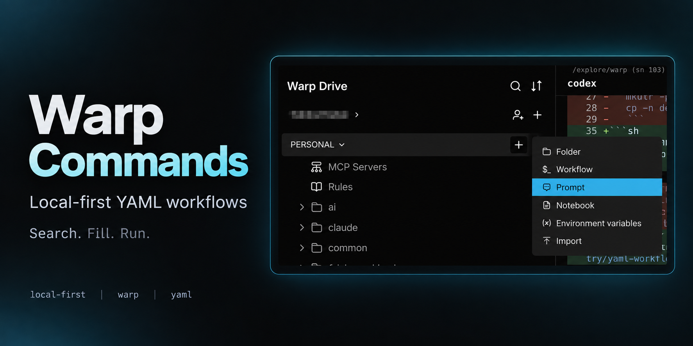
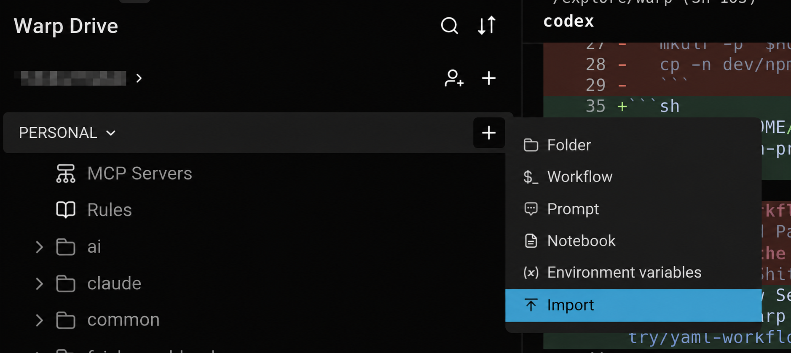

# Warp Commands

[English](README.md) · [简体中文](README.zh-CN.md) · 日本語

**普段使っている Warp コマンド。あなたにも役立つものがあれば。**



[local-first](https://github.com/topics/local-first) · [warp](https://github.com/topics/warp) · [yaml](https://github.com/topics/yaml)

## こんなときに

- **macOS の Caps Lock 遅延** — [mac caps delay](mac/mac-caps-delay.yaml)：私の Mac では、この `hidutil` コマンドで解消できました。
- **iCloud の Obsidian 保管庫を開く** — [obsidian](mac/obsidian.yaml)：`cd` コマンドを直接実行できます。各 Mac に [`cnotes` をインストール](setup/)すると、短いコマンドでも移動できます。
- **eza でプロジェクトを一覧表示** — [projects](mac/projects.yaml)：[一度インストール](setup/)すれば、`projects` でプロジェクト名、Git ブランチ、状態をまとめて確認できます。既定の `~/codex` の代わりに、自分のディレクトリも指定できます。
- **複数プロジェクトの main を更新** — [projects pull](mac/projects-pull.yaml)：[一度インストール](setup/)すれば、`projects-pull` で各プロジェクトの `origin/main` からローカルの `main` を fast-forward 更新できます。現在のブランチは維持されます。
- **Windows で WSL を使う** — [wsl](wsl/)：Ubuntu の起動、バージョンと保存先の確認、フォルダ表示、Ubuntu パッケージの管理。[WSL ガイド（中国語）](notes/wsl-guide.md)で実行するシェルと D ドライブへの移動手順を確認できます。

## 使ってみる

1. **クローン**

   ```sh
   git clone https://github.com/yuukiLike/warp-commands.git
   ```

2. **インポート** — Warp Drive → 個人用ワークスペースの **+ → Import** を開きます。クローンした `warp-commands/` の中から、必要な `.yaml` ファイルか `mac/`、`git/` などのコマンド用フォルダを選びます。**リポジトリ全体のフォルダは選ばないでください。**
3. **実行** — `mac clipboard` などを検索し、ワークフローを選んで引数を入力し、実行します。

`assets/` は README 用の画像、Markdown ファイルと `notes/` は説明や参考ノートです。**これらのインポートは不要です。** `setup/` の YAML はインストール用ワークフローなので、必要なものをインポートしてください。



インポートすると、Warp Drive で同期されるコピーが作成されます。元の YAML はリポジトリで管理してください。[インポートガイド →](https://docs.warp.dev/knowledge-and-collaboration/warp-drive/#importing-files-into-warp-drive)

## 必要なものを選ぶ

| フォルダ | 内容 |
| --- | --- |
| [mac](mac/) | クリップボード、DNS、Caps Lock、Zsh 設定、Obsidian、プロジェクト一覧と main の一括更新 |
| [wsl](wsl/) | Windows PowerShell の管理コマンドと Ubuntu Bash/Zsh ワークフロー；[ガイド（中国語）](notes/wsl-guide.md) |
| [setup](setup/) | Warp で一度インストールし、`.zshrc` から読み込む `cnotes`、一覧表示の `projects`、一括更新の `projects-pull` |
| [git](git/) | Git 操作、除外ルール、SSH |
| [claude](claude/) | Claude Code のインストール、API 切り替え、環境のリセット |
| [ai](ai/) | Codex、Gemini、DeepSeek 経由の Claude Code・Codex |
| [browser](browser/) | Chrome キャッシュ、証明書のデバッグ、Puppeteer |
| [dev](dev/) | npm、Whistle、Rust、Vue |
| [system](system/) | グローバル IP と Windows ユーティリティ |
| [notes](notes/) | Git、SSH、シェル、WSL の参考ノート |

Windows のワークフローは PowerShell または Git Bash を使います。各ワークフローの説明を確認してください。

WSL を使う場合は `wsl/` 内の YAML をインポートし、`wsl` を検索してください。各説明の先頭に実行環境を記載しています。`wsl apt install` は起動後にパッケージ名を一つ入力します。ディストリビューションを移動する前に、[D ドライブへの移動手順](notes/wsl-guide.md#迁移-ubuntu-到-d-盘)を確認してください。

## 一度インストールして使う

`setup/` から必要な YAML をインポートします。各 Mac の Warp で **`setup obsidian`**、**`setup projects`** または **`setup projects pull`** を検索し、選択して実行してください。リポジトリのパス指定は不要です。

ワークフローはコマンド定義を `~/.config/warp-commands/` に保存し、`.zshrc` に読み込み行を追加して、現在のターミナルにも反映します。`setup projects` は必要に応じて Homebrew で `eza` もインストールします。その後は `cnotes`、`projects "$HOME/explore"`、`projects-pull "$HOME/explore"` を使えます。対応するプロジェクトの YAML も、インストール済みの関数を呼び出します。`projects-pull` は単独でインストールでき、Git と Zsh だけが必要です。

更新するときは、Warp 内の該当ワークフローを更新し、各 Mac でもう一度インストールを実行してください。既存の `.zshrc` 設定は保持され、読み込み行は重複しません。詳しくは [setup](setup/) を参照してください。

## ローカルファイルから使う

ローカルの YAML を直接読み込む場合は、必要なワークフローを次の場所にコピーします。

| OS | ディレクトリ |
| --- | --- |
| macOS | `$HOME/.warp/workflows/` |
| Windows（PowerShell） | `$env:APPDATA\warp\Warp\data\workflows\` |

Warp の Workflow Search から利用できます。元のファイルを更新したら、コピーも更新してください。[YAML ワークフローガイド →](https://docs.warp.dev/terminal/entry/yaml-workflows)
