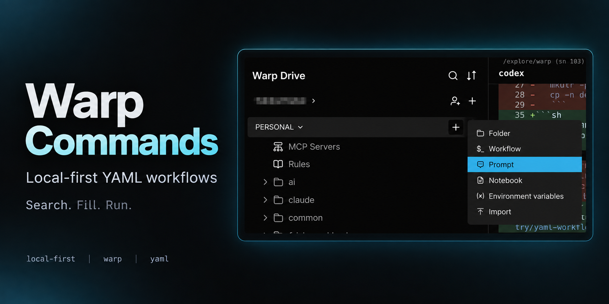

# Warp Commands

English · [简体中文](README.zh-CN.md) · [日本語](README.ja.md)

Warp YAML workflows I use. Take what you need.



## Use

```sh
git clone https://github.com/yuukiLike/warp-commands.git
```

1. In Warp Drive → personal workspace **+ → Import**, select YAML files or command folders, not the entire repository.
2. Search, fill in arguments, and run. Check each workflow for its required shell.

Imports are copies; refresh them when the repository changes. See [setup](setup/) to install or update `cnotes`, `projects`, and `projects-pull`.

[Import screenshot](assets/warp-import.png) · [Local YAML usage](https://docs.warp.dev/terminal/entry/yaml-workflows)

## Folders

| Folder | Contents |
| --- | --- |
| [mac](mac/) | macOS tools, Obsidian, project overview and batch main updates |
| [wsl](wsl/) | Windows / Ubuntu tools · [guide (Chinese)](notes/wsl-guide.md) |
| [setup](setup/) | Install `cnotes`, `projects`, and `projects-pull` |
| [git](git/) | Git and SSH |
| [claude](claude/) | Claude Code installation and configuration |
| [pi](pi/) | Pi models, reasoning levels, overwrite and incremental setup |
| [ai](ai/) | Codex, Gemini, DeepSeek |
| [browser](browser/) | Chrome and Puppeteer |
| [dev](dev/) | npm, Whistle, Rust, Vue |
| [system](system/) | Public IP and Windows tools |
| [notes](notes/) | Reference notes |
