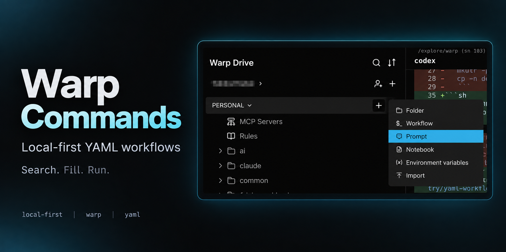

# Warp Commands

[English](README.md) · 简体中文 · [日本語](README.ja.md)

我日常使用的 Warp YAML 工作流，按需取用。



## 使用

```sh
git clone https://github.com/yuukiLike/warp-commands.git
```

1. 在 Warp Drive → 个人空间 **+ → Import** 中选择需要的 YAML 或命令目录，别导入整个仓库。
2. 搜索命令、填写参数、运行。执行环境见各工作流说明。

导入的是副本，仓库更新后需同步更新。`cnotes`、`projects`、`projects-pull` 的安装与更新见 [setup](setup/)。

[导入示意图](assets/warp-import.png) · [本地 YAML 用法](https://docs.warp.dev/terminal/entry/yaml-workflows)

## 目录

| 目录 | 内容 |
| --- | --- |
| [mac](mac/) | macOS 工具、Obsidian、项目概览与批量更新 main |
| [wsl](wsl/) | Windows / Ubuntu 工具 · [指南](notes/wsl-guide.md) |
| [setup](setup/) | 安装 `cnotes`、`projects`、`projects-pull` |
| [git](git/) | Git 与 SSH |
| [claude](claude/) | Claude Code 安装与配置 |
| [pi](pi/) | Pi 常用模型、思考级别配置与快捷键速查 |
| [ai](ai/) | Codex、Gemini、DeepSeek |
| [browser](browser/) | Chrome 与 Puppeteer |
| [dev](dev/) | npm、Whistle、Rust、Vue |
| [system](system/) | 公网 IP 与 Windows 工具 |
| [notes](notes/) | 参考笔记 |
